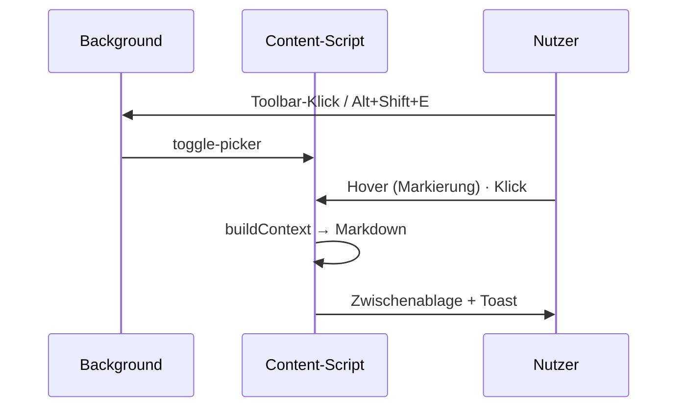

<p align="center">
  
</p>

<h1 align="center">DOM Picker für LLM</h1>

<p align="center">
  <b>Element in Firefox anklicken, Kontext ins LLM einfügen.</b><br>
  HTML · Passende CSS-Regeln · Computed Styles · Sichtbarer Text
</p>

<p align="center">
  
  
  
  
  <a href="LICENSE"></a>
</p>

<p align="center"><a href="README.md">English</a> · <b>Deutsch</b></p>

Wie der Element-Selector in VS Code: Element im Browser anfahren, anklicken – die Extension
erzeugt daraus einen kompakten Kontext (HTML, passende CSS-Regeln, Computed Styles, Text),
kopiert ihn in die Zwischenablage und ist damit direkt als LLM-Prompt nutzbar. **Kein Popup** –
Steuerung läuft komplett über Toolbar-Icon und Shortcut. Die Texte folgen der Browsersprache
(Englisch oder Deutsch).

> **Beta:** Der Kernablauf funktioniert; Sonderfälle sind bewusst minimal behandelt.

## Schnellstart

```bash
npm install
npm run build      # → dist/
npm start          # bauen + Firefox mit der Extension starten (web-ext)
```

Oder manuell laden: `about:debugging` → **Dieser Firefox** → **Temporäres Add-on laden** →
`dist/manifest.json`. Nach jedem Build dort auf **Neu laden** klicken.

| Befehl | Beschreibung |
| --- | --- |
| `npm run dev` | Build im Watch-Modus |
| `npm test` | Build + Test der Content-Pipeline (jsdom) |
| `npm run check` | Typecheck + Tests + `web-ext lint` |
| `npm run icons` | PNG-Icons aus `public/icons/icon.svg` neu erzeugen |

## Benutzung

- **Toolbar-Icon klicken** oder **Alt+Shift+E** → Picker startet
  (erneut klicken / Shortcut / **Esc** beendet ihn)
- Element anfahren → blaue Markierung mit Tag-/Klassen-Label
- **Klick** übernimmt: Kontext wird erzeugt und in die Zwischenablage kopiert (Toast bestätigt)
- Mit Strg+V in den LLM-Chat einfügen – fertig

## Funktionsweise



```text
src/
  background/   Event-Page: Toolbar-Klick + Shortcut → toggle-picker
  content/      Content-Script: picker.ts · ui.ts (Overlay, Toasts) · context.ts (Markdown)
                extract.ts (Selector, HTML, CSS-Regeln, Computed Styles) · settings.ts
  shared/       messages.ts · i18n.ts (browser.i18n, typisierte Schlüssel)
public/         manifest.json · _locales/ (en, de) · icons/
scripts/        build.mjs (esbuild → 2 IIFE-Bundles) · build-icons.mjs
tests/          content-smoke.mjs (Kontext-Pipeline in jsdom)
```

Regel: `content/` und `background/` importieren nur aus `shared/`, nie voneinander.

### Erzeugter Kontext (Markdown)

Siehe [README.md](README.md#generated-context-markdown) – die Ausgabe ist immer Englisch,
damit sie in jedem LLM-Prompt gleich aussieht.

### Optionen (ohne UI)

Standardmäßig ist alles aktiviert. Anpassen lässt es sich in der Konsole des Add-ons
(`about:debugging` → **Untersuchen** → Konsole):

```js
browser.storage.local.set({ settings: {
  includeCssRules: true,   // autorierte CSS-Regeln aus Stylesheets
  includeComputed: true,   // Computed-Styles-Auszug
  includeAncestors: true,  // Ancestor-Kette
  maxHtmlChars: 6000,      // Limit für outerHTML
  maxTextChars: 800,       // Limit für sichtbaren Text
}})
```

Der zuletzt erzeugte Kontext liegt außerdem unter `browser.storage.local.get('lastCapture')`.

## Grenzen

- Fremde Stylesheets ohne CORS (CDN ohne `crossorigin`) sind nicht lesbar – deren Regeln
  fehlen, Computed Styles decken das größtenteils ab.
- Shadow-DOM wird nicht durchdrungen (Picker stoppt am Shadow-Host).
- iframes werden nicht unterstützt (das Content-Script läuft nur im Top-Frame).

Änderungen: [CHANGELOG.md](CHANGELOG.md) · Lizenz: [MIT](LICENSE)
