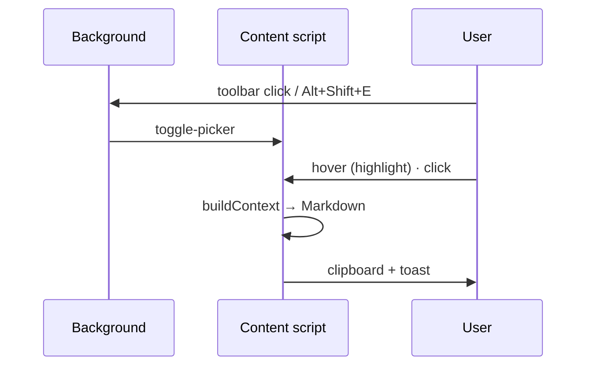

<p align="center">
  
</p>

<h1 align="center">DOM Picker für LLM</h1>

<p align="center">
  <b>Pick an element in Firefox, paste its context into your LLM.</b><br>
  HTML · Matching CSS rules · Computed styles · Visible text
</p>

<p align="center">
  
  
  
  
  <a href="LICENSE"></a>
</p>

<p align="center"><b>English</b> · <a href="README.de.md">Deutsch</a></p>

Like the element selector in VS Code: hover an element in the browser, click it – the extension
builds a compact context (HTML, matching CSS rules, computed styles, text), copies it to the
clipboard and it is ready to paste as an LLM prompt. **No popup** – everything runs via the
toolbar button and a shortcut. UI texts follow the browser language (English or German).

> **Beta:** the core flow works; edge-case handling is deliberately minimal.

## Quick start

```bash
npm install
npm run build      # → dist/
npm start          # build + start Firefox with the extension (web-ext)
```

Or load it manually: `about:debugging` → **This Firefox** → **Load Temporary Add-on** →
`dist/manifest.json`. After every build click **Reload** there.

| Command | Description |
| --- | --- |
| `npm run dev` | Build in watch mode |
| `npm test` | Build + content-pipeline test (jsdom) |
| `npm run check` | Typecheck + tests + `web-ext lint` |
| `npm run icons` | Regenerate PNG icons from `public/icons/icon.svg` |

## Usage

- **Click the toolbar button** or press **Alt+Shift+E** → the picker starts
  (click / shortcut again or **Esc** stops it)
- Hover an element → blue highlight with a tag/class label
- **Click** picks it: the context is built and copied to the clipboard (a toast confirms)
- Paste it into your LLM chat with Ctrl+V

## How it works



```text
src/
  background/   event page: toolbar click + shortcut → toggle-picker
  content/      content script: picker.ts · ui.ts (overlay, toasts) · context.ts (Markdown)
                extract.ts (selector, HTML, CSS rules, computed styles) · settings.ts
  shared/       messages.ts · i18n.ts (browser.i18n, typed keys)
public/         manifest.json · _locales/ (en, de) · icons/
scripts/        build.mjs (esbuild → 2 IIFE bundles) · build-icons.mjs
tests/          content-smoke.mjs (context pipeline in jsdom)
```

Rule: `content/` and `background/` import only from `shared/`, never from each other.

### Generated context (Markdown)

````markdown
# Selected DOM element context
- Page: … — https://…
- Element: `div.card > h2:nth-of-type(1)`
- Ancestors: `body < div#app < main …`

## HTML
```html
… cleaned outerHTML, truncated to N characters …
```

## Matching CSS rules (authored)
```css
.card h2 { font-size: 1.25rem; … } /* from: styles.css */
/* @media (max-width: 768px) */
.card h2 { … } /* from: styles.css */
```

## Computed styles (excerpt)
```css
div.card > h2:nth-of-type(1) {
  display: block; …
}
```

## Visible text
"…"
````

### Options (no UI)

Everything is enabled by default. To change it, use the add-on console
(`about:debugging` → **Inspect** → Console):

```js
browser.storage.local.set({ settings: {
  includeCssRules: true,   // authored CSS rules from the stylesheets
  includeComputed: true,   // computed styles excerpt
  includeAncestors: true,  // ancestor chain
  maxHtmlChars: 6000,      // limit for outerHTML
  maxTextChars: 800,       // limit for visible text
}})
```

The last generated context is also stored under `browser.storage.local.get('lastCapture')`.

## Limitations

- Cross-origin stylesheets without CORS (CDN without `crossorigin`) can't be read – their rules
  are missing; computed styles cover most of it.
- Shadow DOM is not pierced (the picker stops at the shadow host).
- iframes are not supported (the content script runs in the top frame only).

Changes: [CHANGELOG.md](CHANGELOG.md) · License: [MIT](LICENSE)
